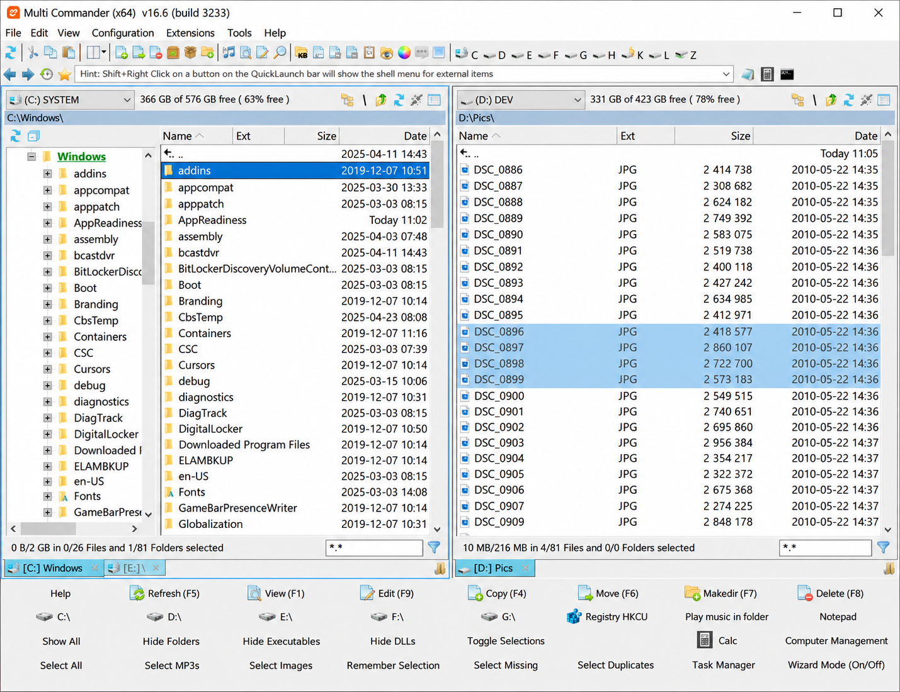
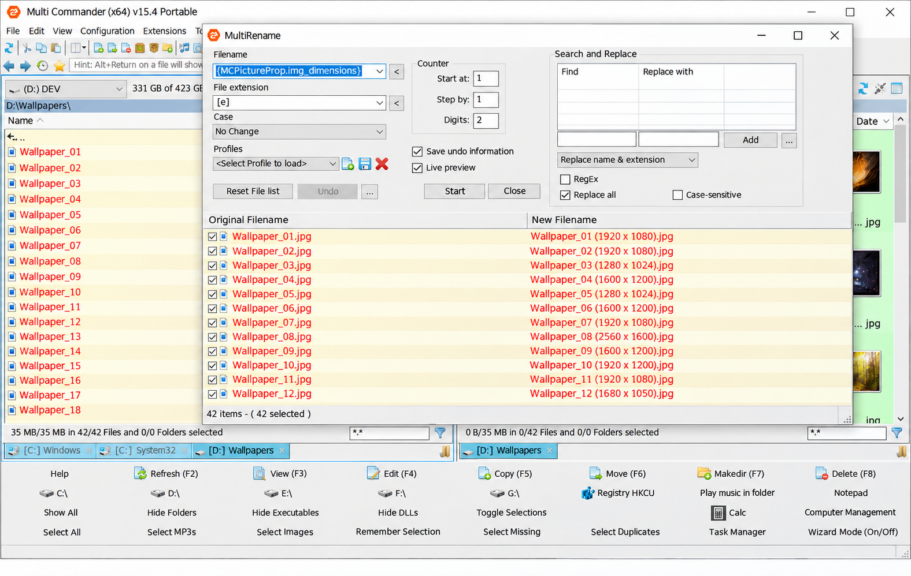
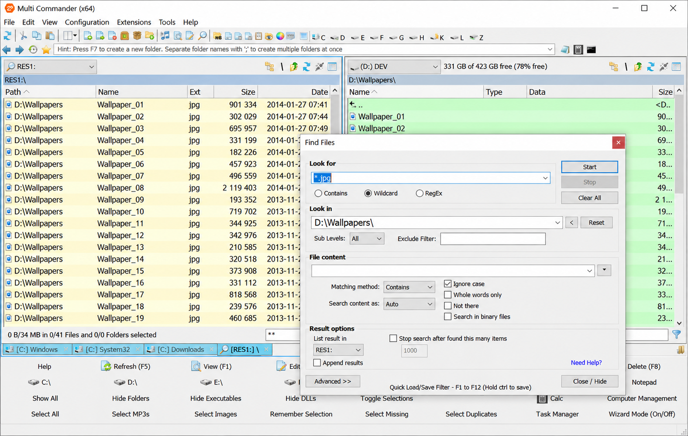

# Multi Commander File Manager - Fast Dual-Panel File Management For Windows

Multi Commander File Manager is a portable, multi-tab Windows file manager maintained by Multi Commander Portable. It combines dual-panel navigation, file previews, configurable storage, search, bulk rename, split and merge operations, archive workflows, and customizable shortcuts.

## Features

- Dual-panel file management for copying, moving, renaming, and organizing files.
- Multi-tab navigation backed by the [tab container](Explorer++/Explorer++/TabContainer.cpp), [tab view](Explorer++/Explorer++/TabView.cpp), and [main tab view](Explorer++/Explorer++/MainTabView.cpp).
- Portable configuration through XML or the Windows registry.
- Search by file name and attributes through the [search dialog](Explorer++/Explorer++/SearchDialog.cpp).
- Folder monitoring with the [file-system watcher](Explorer++/Explorer++/FileSystemWatcher.cpp).
- Bulk editing through the [mass rename dialog](Explorer++/Explorer++/MassRenameDialog.cpp).
- File splitting and merging through the [split](Explorer++/Explorer++/SplitFileDialog.cpp) and [merge](Explorer++/Explorer++/MergeFilesDialog.cpp) tools.
- Clipboard, drag-and-drop, navigation, shell integration, and session restoration.
- Light and dark interface support through the [theme manager](Explorer++/Explorer++/ThemeManagerImpl.cpp).
- A customizable Multi Commander preview panel for inspecting selected content.
- Multi Commander custom hotkeys for efficient keyboard-based navigation.
- Multi Commander compare folders and Multi Commander compare files workflows.
- Multi Commander archive browser, Multi Commander ZIP viewer, and Multi Commander auto unpack archives workflows.
- Multi Commander FTP client and Multi Commander SFTP client workflows.
- Multi Commander registry editor and Multi Commander checksum calculator tools.
- Multi Commander scripting support for repeatable file-management tasks.

Multi Commander Portable is designed for Windows users who want a Multi Commander dual panel file manager without giving up multi-tab navigation. The Multi Commander File Manager interface supports focused file operations while reusable components such as [BrowserPane](Explorer++/Explorer++/BrowserPane.cpp), [BrowserView](Explorer++/Explorer++/BrowserView.cpp), and [FolderView](Explorer++/Explorer++/FolderView.cpp) separate navigation from presentation.

### What is Total Commander software?

Total Commander is a dual-panel file manager for Windows. It popularized side-by-side file management, keyboard-driven operations, archive handling, and extensible workflows.

## Installing and running Multi Commander File Manager

Multi Commander Portable is intended to run as a portable file manager on supported Windows systems. The same Multi Commander File Manager workspace can retain configuration in XML files or use registry-backed storage.

The startup path is implemented by [Application](Explorer++/Explorer++/Application.cpp), [Runtime](Explorer++/Explorer++/Runtime.cpp), and the [startup command-line processor](Explorer++/Explorer++/StartupCommandLineProcessor.cpp). Command-line parsing is isolated in [CommandLine](Explorer++/Explorer++/CommandLine.cpp), while previous tabs and locations can be recovered through [SessionRestorer](Explorer++/Explorer++/SessionRestorer.cpp).

### Is Total Commander File Manager free?

Total Commander is commercial shareware.

## Configuration

Multi Commander Portable supports two configuration approaches:

| Storage | Implementation | Intended Use |
| --- | --- | --- |
| XML configuration | [ConfigXmlStorage](Explorer++/Explorer++/ConfigXmlStorage.cpp) and [XmlAppStorage](Explorer++/Explorer++/XmlAppStorage.cpp) | Portable configuration kept with the application |
| Registry configuration | [ConfigRegistryStorage](Explorer++/Explorer++/ConfigRegistryStorage.cpp) and [RegistryAppStorage](Explorer++/Explorer++/RegistryAppStorage.cpp) | Conventional Windows profile storage |

The shared [storage interface](Explorer++/Explorer++/Storage.h) keeps configuration behavior separate from the Multi Commander File Manager interface. This design allows Multi Commander Portable to support portable and installed usage without duplicating application logic.

### File Manager Terms

Multi commander, multi commander file manager, multi commander portable, multi commander dual panel file manager, multi commander portable file manager, dual-pane, multi-tab, portable, archive-manager, ftp-client, sftp-client, windows-file-manager, file-management

## Preview Support

The Multi Commander preview panel complements the dual-panel and multi-tab layout by displaying information about selected files without disrupting navigation.

| Area | Support |
| --- | --- |
| Browser layout | Separate panes and reusable browser views |
| Folder display | Shell-backed folder enumeration and icon loading |
| Selection handling | Clipboard and file-operation integration |
| Appearance | Light and dark theme management |
| Updates | File-system and directory watchers |

Shell content is represented through [ShellEntry](Explorer++/Explorer++/ShellEntry.cpp) and [ShellEntryCollection](Explorer++/Explorer++/ShellEntryCollection.cpp). Enumeration, name parsing, and icons are handled by [ShellEnumeratorImpl](Explorer++/Explorer++/ShellEnumeratorImpl.cpp), [ShellNameParserImpl](Explorer++/Explorer++/ShellNameParserImpl.cpp), and [ShellIconLoaderImpl](Explorer++/Explorer++/ShellIconLoaderImpl.cpp).

### Is Midnight Commander a file manager?

Yes. Midnight Commander is a terminal-based, dual-panel file manager commonly used on Unix-like systems.

Multi Commander File Manager is a Windows graphical application rather than a terminal interface. Multi Commander Portable provides tabs, shell integration, Windows-native file operations, themes, previews, and persistent sessions while retaining the efficient two-panel concept.

## File Operations

The Multi Commander File Manager source separates common operations into focused components:

- [FileOperations](Explorer++/Explorer++/FileOperations.cpp) coordinates core file actions.
- [ClipboardOperations](Explorer++/Explorer++/ClipboardOperations.cpp) integrates copy-and-paste workflows.
- [DirectoryOperationsHelper](Explorer++/Explorer++/DirectoryOperationsHelper.cpp) supports directory-level tasks.
- [FileProgressSink](Explorer++/Explorer++/FileProgressSink.cpp) receives operation progress.
- [ProcessManager](Explorer++/Explorer++/ProcessManager.cpp) manages launched processes.
- [DestroyFilesDialog](Explorer++/Explorer++/DestroyFilesDialog.cpp) handles destructive-operation confirmation.
- [NavigationHelper](Explorer++/Explorer++/NavigationHelper.cpp) centralizes location changes.
- [BrowserCommandController](Explorer++/Explorer++/BrowserCommandController.cpp) maps interface commands to browser actions.

These components support Multi Commander Windows 11 and Multi Commander Windows 10 workflows while keeping file operations independent from tabs and presentation.

## Development

### Prerequisites

Development requires a Windows C++ toolchain capable of opening the included Visual Studio solution and project files:

- [Explorer++.sln](Explorer++/Explorer++.sln)
- [Explorer++.vcxproj](Explorer++/Explorer++/Explorer++.vcxproj)
- [Application manifest](Explorer++/Explorer++/Explorer++.exe.manifest)

### Code Editing

The repository includes shared formatting and analysis settings:

- [.clang-format](.clang-format)
- [.clang-tidy](.clang-tidy)
- [.editorconfig](.editorconfig)
- [.gitattributes](.gitattributes)
- [.gitignore](.gitignore)

The application entry and service wiring are defined in [App](Explorer++/Explorer++/App.cpp), [ApplicationHelper](Explorer++/Explorer++/ApplicationHelper.cpp), and [AppServices](Explorer++/Explorer++/AppServices.cpp).

### How to Run

Open the solution, select the required Windows architecture and build configuration, and build the Multi Commander File Manager project. Run the generated application from the selected output configuration.

### How to Debug

Start Multi Commander File Manager under the Visual Studio debugger. Useful debugging boundaries include startup processing, browser command dispatch, file operations, storage selection, shell enumeration, and directory notifications.

## Project Status

Multi Commander Portable is organized as a native Windows application with independent modules for browsing, tabs, themes, shell access, persistence, and file operations. The repository name is Multi Commander File Manager, and the implementation remains suitable for continued development and review.

## Contributing

Contributions to Multi Commander File Manager should follow the repository formatting and static-analysis configuration. Changes should preserve Windows shell behavior, storage compatibility, tab restoration, operation progress reporting, and the portable configuration model.

Review the existing [README](README) before submitting changes to Multi Commander Portable.

## License

[LICENSE](LICENSE)
